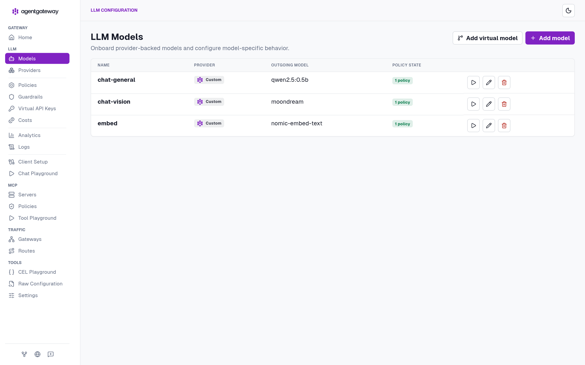
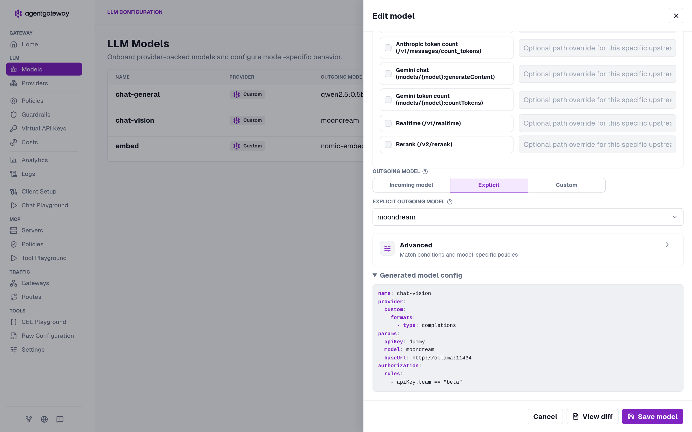
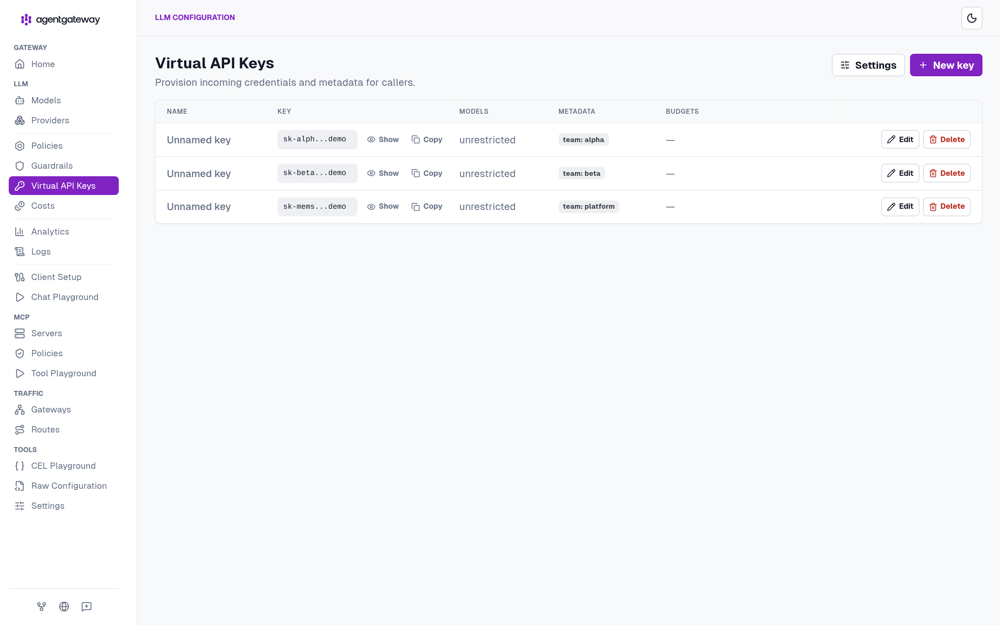
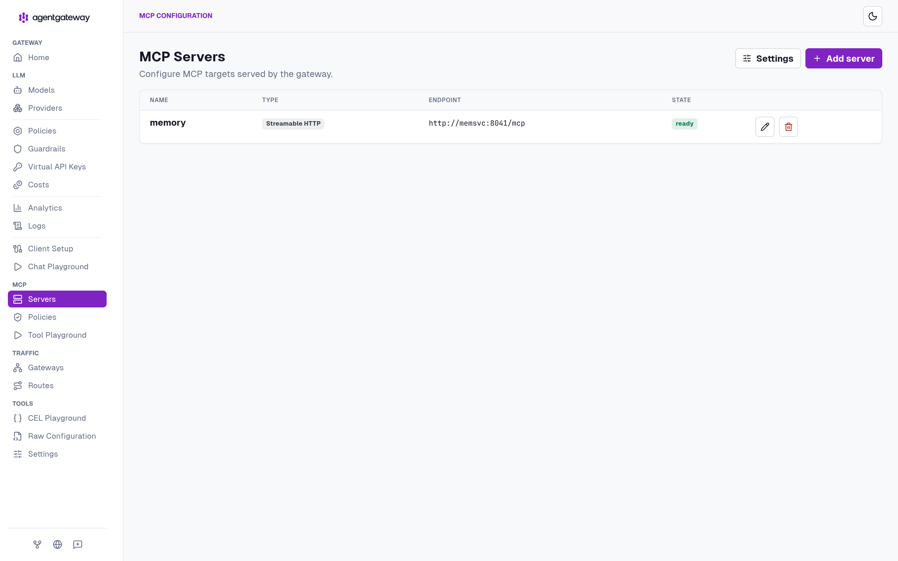
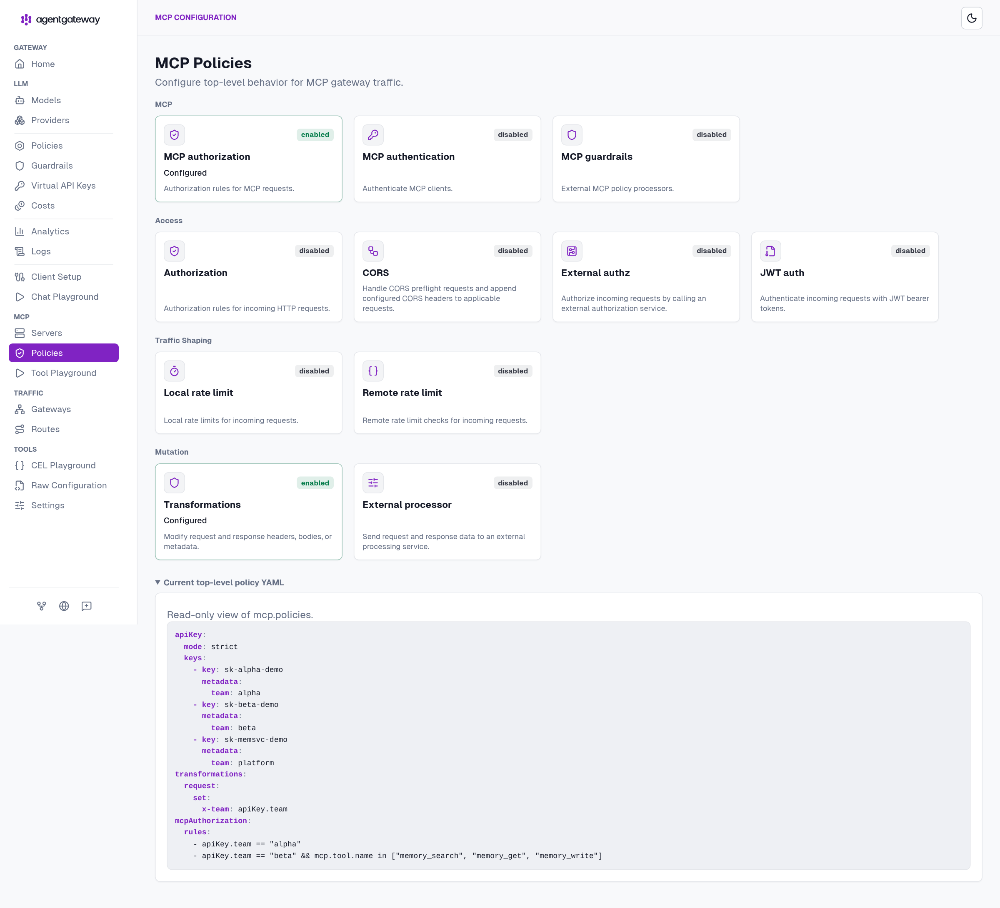
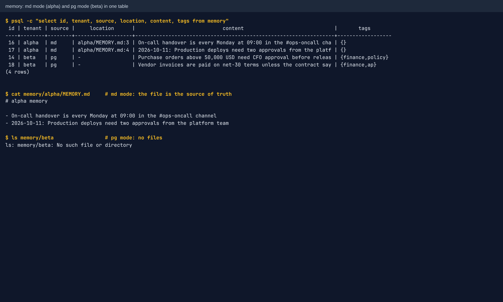
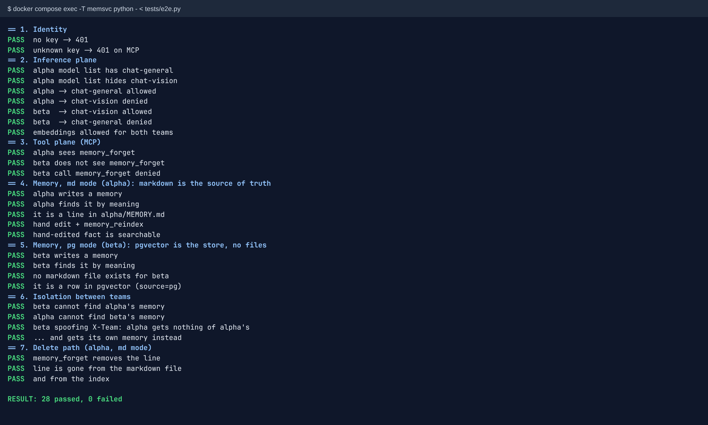
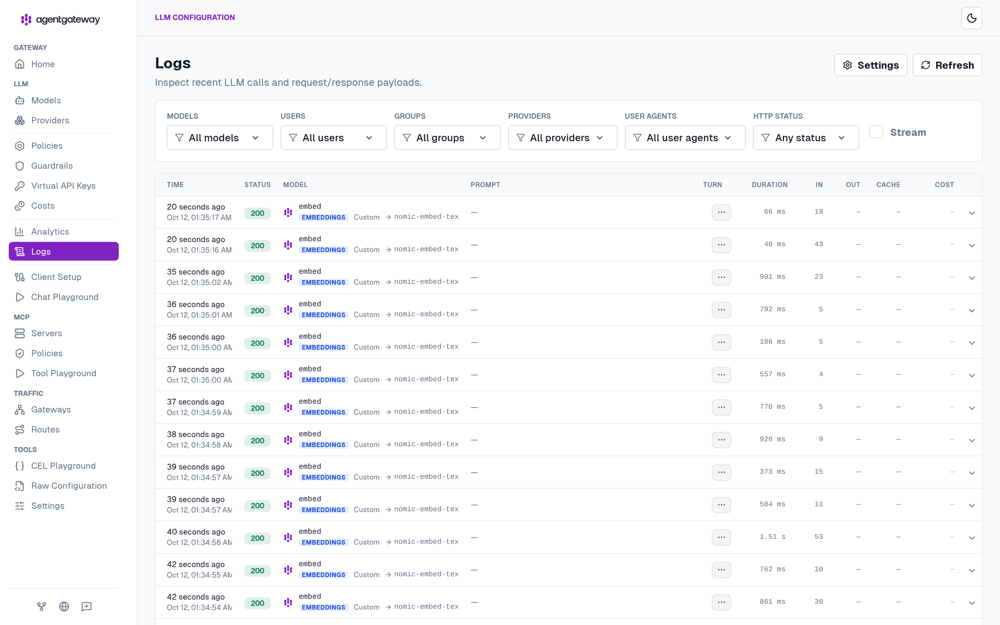

# tenantfabric

**A multi-team AI platform in one file.** Give every dev team one API key. That key decides which models the team can call, which MCP tools it can use, which command-line credentials it can act with, and whose memory it can read. Deploy it with one Docker Compose file or one Kubernetes manifest.

| Plane | What a team gets | Enforced by |
|---|---|---|
| Inference | only its own models. Other models return 403 and don't appear in `/v1/models` | [agentgateway](https://github.com/agentgateway/agentgateway): a per-model rule on `apiKey.team` |
| Tools (MCP) | only its own tools. Other tools are missing from `tools/list`, and calls to them are rejected | agentgateway `mcpAuthorization` on `apiKey.team` + `mcp.tool.name` |
| CLI tools | its own runner container for `curl`, `aws`, `jq`, ..., holding only that team's credentials | a per-team gateway route, the runner's own team check, and the network |
| Memory | only its own memory, even if the client lies about who it is | [memsvc](https://github.com/anindyar/memsvc): the gateway stamps the team from the key, and Postgres row-level security enforces it |

Everything is open source: agentgateway, Postgres + pgvector, Ollama for the example models, and memsvc for memory. It runs on CPU as-is, amd64 or arm64. Point the model aliases at your own GPU servers or a cloud API when you're ready.

---

## Quick start

### Docker Compose

```bash
git clone https://github.com/anindyar/tenantfabric && cd tenantfabric
docker compose up -d                                       # first start pulls ~3 GB of example models
docker compose logs -f models                              # wait until it exits (models pulled)
docker compose exec -T memsvc python - < tests/e2e.py      # 52 end-to-end checks
```

The gateway UI is at http://localhost:8080/ui. Set `GATEWAY_PORT=9090` to use another port. Run `docker compose down -v` to remove everything.

### Kubernetes

```bash
kubectl apply -f k8s/tenantfabric.yaml
kubectl -n tenantfabric wait --for=condition=complete job/models --timeout=30m
kubectl -n tenantfabric exec -i deploy/memsvc -- python - < tests/e2e.py
kubectl -n tenantfabric port-forward svc/agentgateway 8080:8080   # UI at http://localhost:8080/ui
```

You need a default StorageClass (4 PVCs, about 17 GiB). The NetworkPolicies only take effect if your CNI enforces them (Calico, Cilium, kindnet and others). Run `kubectl delete namespace tenantfabric` to remove everything.

### With an AI coding assistant

Give your assistant (Claude Code, Cursor, Copilot, Codex, ...) the repo link and a goal, for example:

> Clone https://github.com/anindyar/tenantfabric, read CLAUDE.md, and deploy it on my Kubernetes cluster. Point `chat-general` at our vLLM server at http://vllm.ai.svc:8000 serving `Qwen/Qwen3-32B`. Add a team called `data` with access to `chat-general` and all memory tools, in pg memory mode. Run the e2e test when done.

[`CLAUDE.md`](CLAUDE.md) (also available as `AGENTS.md`) gives the assistant the full context: architecture, the security invariants it must keep, and step-by-step recipes.

---

## Architecture

```
 dev team (one API key)
     │  OpenAI SDK / curl                     MCP client (Claude Code, Cursor, agent SDK)
     ▼                                               ▼
 ┌──────────────────────── agentgateway :8080 ─────────────────────────┐
 │ API key → metadata {team: alpha}                                     │
 │ /v1/chat/completions, /v1/models → per-model rule on apiKey.team     │
 │ /v1/embeddings                   → model "embed"                     │
 │ /mcp                             → mcpAuthorization per tool         │
 │                                    + sets header X-Team = apiKey.team │
 │ /ui                              → admin UI, request logs            │
 └───────┬─────────────────────────────────────────┬───────────────────┘
         ▼                                         ▼
   ollama :11434 (example)                  memsvc :8041 (gateway-only)
   chat-general → qwen2.5:0.5b              5 memory_* MCP tools
   chat-vision  → moondream                 md mode: /srv/memory/<team>/*.md + index rows
   embed        → nomic-embed-text          pg mode: rows only
         ▲                                         │
         └──── memsvc embeds through the gateway ──┤
                                                   ▼
                                     postgres + pgvector :5432
                                     memory table with RLS per team, gateway request logs

 Tools, on the same gateway and key:
   /mcp        → memsvc + tools :8050          shared MCP tools: utc_now, calculate, http_get
   /cli/alpha  → cli-alpha :8060               alpha's runner: curl, aws, jq + alpha's AWS credentials
   /cli/beta   → cli-beta  :8060               beta's runner:  curl, jq, no credentials
```

Only the gateway is exposed. memsvc and the CLI runners trust the `X-Team` header, so nothing except the gateway may reach them. On Kubernetes NetworkPolicies enforce this. On Compose, only the gateway port is published, and the tool server and each runner sit on their own network shared only with the gateway.

### Example teams

| | alpha (e.g. platform engineering) | beta (e.g. finance ops) |
|---|---|---|
| API key | `sk-alpha-demo` | `sk-beta-demo` |
| Models | `chat-general`, `embed` | `chat-vision`, `embed` |
| Memory mode | `md`: markdown files are the truth, pgvector is the index | `pg`: pgvector rows only, no files |
| Memory tools | all five | `memory_write`, `memory_search`, `memory_get` (cannot delete or reindex) |
| Shared tools | `utc_now`, `calculate`, `http_get` | `utc_now`, `calculate` (no network access) |
| CLI runner | `/cli/alpha`: `curl`, `aws`, `jq`, with alpha's AWS credentials | `/cli/beta`: `curl`, `jq`, no credentials |

### Model aliases

Teams call stable names. The gateway maps each one to a backend, so swapping a backend is one line in the gateway config and clients don't change.

| Alias | Example backend (CPU, small) | Replace with |
|---|---|---|
| `chat-general` | `qwen2.5:0.5b` on Ollama | any OpenAI-compatible chat model (vLLM, TGI, llama.cpp, a cloud API) |
| `chat-vision` | `moondream` on Ollama | a vision-language model |
| `embed` | `nomic-embed-text` on Ollama (768-dim) | any embedder. **The vector size in the schema must match** |

---

## Walkthrough

**Models and aliases.** Each alias has one authorization rule:





**Team keys.** The same keys also scope the MCP tools:



**MCP: one memory target, per-team tool rules, and the `X-Team` stamp:**





**Memory in both modes, in one table.** alpha's rows point back to lines in its markdown file. beta's rows are the memory itself:



**End-to-end test.** It covers identity, model scoping, tool scoping, both memory modes, isolation including a forged team header, and the delete path:



**Audit trail.** Every model call is logged in the gateway UI:



---

## Using it as a team

```bash
# chat
curl http://localhost:8080/v1/chat/completions -H "Authorization: Bearer sk-alpha-demo" \
  -H 'content-type: application/json' -d '{"model":"chat-general","messages":[{"role":"user","content":"hi"}]}'
```

For memory, add the gateway as an MCP server in your client: URL `http://<gateway>:8080/mcp` (streamable HTTP), header `Authorization: Bearer <team key>`. For example, with Claude Code:

```bash
claude mcp add --transport http team-memory http://localhost:8080/mcp --header "Authorization: Bearer sk-alpha-demo"
```

| Tool | md mode | pg mode |
|---|---|---|
| `memory_write(text, tags?, file?)` | appends a dated line to `<team>/<file>` (default `MEMORY.md`) | inserts a row with tags |
| `memory_search(query, k?)` | semantic search. Hits carry `id`, and `path`/`line` for md | same |
| `memory_get(id?, file?)` | one item, or the whole markdown file | one item, or the 20 newest |
| `memory_forget(id)` | removes the line from the file and the index. Refuses if the file was edited since indexing | deletes the row |
| `memory_reindex()` | rebuilds the index from the files (after hand edits) | re-embeds every row (after an embedder change) |

---

## Tool calling

Teams get tools in two ways, both through the gateway and both with the same team key.

| | Option 1: MCP tools | Option 2: per-team CLI runner |
|---|---|---|
| Use it for | typed tools: internal APIs, search, tickets, memory | ad-hoc commands: `curl`, `aws`, `jq`, and any CLI you add |
| Endpoint | `/mcp`, shared by every team | `/cli/<team>`, one per team |
| Credentials | held by the tool server (one set for everyone), or none | each team's own, mounted only in that team's runner |
| Who may call what | `mcpAuthorization` rules per team and per tool | only the team's key passes the route, and the runner checks the team |

Models never execute tools. The model returns a `tool_calls` request, your agent or AI client runs the tool over MCP, and passes the result back to the model. In Claude Code, Cursor or any agent SDK, you only register the MCP endpoint. For your own code, [`examples/agent.py`](examples/agent.py) is the whole loop in about 60 lines:

```bash
pip install "mcp>=1.10" httpx
GATEWAY_URL=http://localhost:8080 TEAM_KEY=sk-alpha-demo MODEL=chat-general \
  python examples/agent.py "Use the calculate tool to compute (17 * 3) / 4"
# [8 tools] memory_write, memory_search, memory_get, memory_forget, memory_reindex, utc_now, calculate, http_get
# [tool] calculate({"expression": "17 * 3 / 4"}) -> '12.75'
# The result of the computation (17 * 3) / 4 is 12.75.
```

The tiny demo model calls tools only some of the time, and `moondream` (`chat-vision`) doesn't support tools at all. Point `chat-general` at a real model for agent work.

### Option 1: MCP tools registered in the gateway

Every MCP server is a **target** under `mcp:` in the gateway config. The gateway merges all targets into one MCP endpoint, `/mcp`. Each team then sees only the tools its rules allow. Tools it may not use are missing from `tools/list`, and calls to them are rejected. The example stack registers memsvc and a small shared tool server (`toolbox/tools.py`):

```yaml
mcp:
  prefixMode: never                   # keep tool names as the servers define them (must be unique across targets)
  targets:
  - name: memory
    mcp: { host: "http://memsvc:8041/mcp" }
  - name: tools                       # any streamable-HTTP MCP server is registered like this
    mcp: { host: "http://tools:8050/mcp" }
  policies:
    apiKey: *teamKeys                 # the same team keys as the models
    transformations:
      request:
        set:
          x-team: 'apiKey.team'       # every target learns the caller's team; clients cannot override it
    mcpAuthorization:
      rules:                          # a tool is allowed if any rule matches
      - 'apiKey.team == "alpha"'
      - 'apiKey.team == "beta" && mcp.tool.target == "memory" && mcp.tool.name in ["memory_search", "memory_get", "memory_write"]'
      - 'apiKey.team == "beta" && mcp.tool.target == "tools" && mcp.tool.name in ["utc_now", "calculate"]'
```

To add your own server:
1. Run it next to the gateway, reachable only by the gateway.
2. Add a target with a unique `name` and its `/mcp` URL.
3. Add or extend `mcpAuthorization` rules to grant its tools to teams.
4. Check with each team's key that `tools/list` shows what you expect.

If two servers expose a tool with the same name, set `prefixMode: always`. Tool names then become `<target>_<tool>` (for example `memory_memory_search`), which changes the names clients use. If a tool server needs to know the caller, read the `X-Team` header the gateway sets, the same way memsvc does. A server that only acts on behalf of the platform (like `tools.py`) can ignore it.

Connect a client with the team key:

```bash
claude mcp add --transport http team-tools http://localhost:8080/mcp --header "Authorization: Bearer sk-alpha-demo"
```

### Option 2: per-team CLI runners

Some work is simplest as a command: `aws s3 ls`, `curl` against an internal API, `jq` over the result. A CLI runner is a small MCP server (`toolbox/runner.py`) with two tools, `run_command` and `runner_info`, that runs allowlisted programs. **Each team gets its own runner container, and only that team's credentials are mounted in it.** A team with an AWS secret can run `aws` only as itself, and no other team can reach that runner.

```
 alpha's key ──► /cli/alpha ──► cli-alpha (curl, aws, jq)   env: alpha's AWS_* from Secret cli-alpha-aws
 beta's key  ──► /cli/beta  ──► cli-beta  (curl, jq)        env: no credentials
 beta's key  ──► /cli/alpha ──► 403 from the gateway
```

Three layers keep a team on its own runner:
1. **The gateway route.** `/cli/alpha` admits only keys whose team is `alpha` (`authorization: require`). Any other key gets 403, and a missing key gets 401.
2. **The runner's own check.** The gateway sets `X-Team` from the key. The runner refuses any request whose `X-Team` isn't the one team it serves.
3. **The network.** Only the gateway can reach a runner. On Kubernetes this is a NetworkPolicy. On Compose, each runner is on its own network shared only with the gateway.

Inside a runner:
- Commands run **without a shell**. Pipes, redirects, globs and `$VARS` are not interpreted. To chain tools, call `curl` and then pass its output to `jq` through the `stdin` argument.
- Only the programs in `RUNNER_COMMANDS` may run. Each command has a timeout (`RUNNER_TIMEOUT`, default 60 s) and the output is capped.
- The child process gets a minimal environment (`PATH`, `HOME`, `LANG`) plus the `AWS_*` variables (add other names with `RUNNER_PASS_ENV`, for example `GITHUB_TOKEN`).
- Every call starts with a fresh, empty `HOME` and working directory, deleted afterwards. The AWS CLI reads its config only from read-only files, and `curl` may not load a config file or engine (`-K`, `--config`, `--engine`). So one call cannot plant an alias, a `credential_process` or a `.curlrc` that a later call would run.
- The container runs as non-root with a read-only root filesystem and no Linux capabilities. On Kubernetes it also gets no service account token, and an egress NetworkPolicy blocks the cloud metadata service (`169.254.0.0/16`), so a runner can't pick up the node's own cloud credentials.

The gateway route for a runner:

```yaml
routes:
- name: cli-alpha
  matches: [ { path: { exact: /cli/alpha } } ]
  policies:
    apiKey: *teamKeys
    authorization: { rules: [ { require: 'apiKey.team == "alpha"' } ] }
    transformations: { request: { set: { x-team: 'apiKey.team' } } }
  backends:
  - mcp:
      targets:
      - name: cli
        mcp: { host: "http://cli-alpha:8060/mcp" }
```

Use it from a client:

```bash
claude mcp add --transport http team-cli http://localhost:8080/cli/alpha --header "Authorization: Bearer sk-alpha-demo"
```

or through the agent loop:

```bash
MCP_PATH=/cli/alpha python examples/agent.py "Run: aws sts get-caller-identity"
# [2 tools] run_command, runner_info
# [tool] run_command({"command": "aws sts get-caller-identity"}) -> 'exit 254 ... InvalidClientTokenId ...'
```

With the demo credentials, AWS answers `InvalidClientTokenId`. The command reached AWS with alpha's key, which is the expected result. Put real credentials in place and it returns alpha's account.

**Giving a team real credentials.** On Compose, put them in a `.env` file next to `docker-compose.yml` (`ALPHA_AWS_ACCESS_KEY_ID=...`, `ALPHA_AWS_SECRET_ACCESS_KEY=...`, `ALPHA_AWS_DEFAULT_REGION=...`). `.env` is git-ignored. On Kubernetes, replace the values in Secret `cli-alpha-aws`, or project the Secret from your secret manager with an ExternalSecret. Then restart the runner.

**What this does not protect against.** Anyone holding a team's key, including that team's AI agents, can use and read that team's runner credentials. The boundary is between teams, not inside one. So:
- Give each runner the **least-privilege, short-lived** credentials the team actually needs: an IAM role for read-only S3, not an admin key. Prefer STS or IRSA / workload identity over long-lived keys.
- The gateway authorizes by tool name. It cannot see arguments, so it cannot allow `aws s3 ls` while blocking `aws s3 rm`. Put that limit in the IAM policy.
- A prompt-injected agent can use `curl` to send data out. If that matters, restrict the runner's egress, for example with a NetworkPolicy that allows only your AWS endpoints or an egress proxy.
- Any program with a plugin, config or script mechanism is close to an interpreter. Check how a CLI loads code before you add it to `RUNNER_COMMANDS`.
- On Compose there is no egress policy. On a cloud VM, require IMDSv2 with a hop limit of 1, or block `169.254.169.254` for Docker with a firewall rule, so containers can't read the VM's instance credentials.

---

## Customizing

All of these are covered step by step in [`CLAUDE.md`](CLAUDE.md):
- **Add a team:** add a key, add the team to the model rules and the MCP rules, and set its memory mode in `MEM_MODES`.
- **Register an MCP server:** add it under `mcp.targets`, then grant tools to teams in `mcpAuthorization`.
- **Give a team a CLI runner:** add a runner container with that team's credentials and a `/cli/<team>` route.
- **Swap a model backend:** edit `params.baseUrl` / `params.model` for the alias.
- **Use your own Postgres:** run the schema, then point `MEM_DB` and the gateway `database.url` at it.
- **Production:** replace the demo keys with JWT/OIDC (rules then read `jwt.team`), move secrets to a secret manager, add TLS/ingress, set per-key token budgets, and pin image digests.

## Why memsvc for memory

The usual open-source memory servers ([Graphiti MCP](https://github.com/getzep/graphiti/tree/main/mcp_server), [mem0](https://github.com/mem0ai/mem0)) take the tenant (`group_id`, `user_id`) as an argument **from the client**. On a platform shared by many teams, any team could pass another team's id and read its memory. memsvc has no tenant argument at all. It uses the team the gateway derived from the API key, and Postgres row-level security enforces it. See the [memsvc README](https://github.com/anindyar/memsvc#why-this-exists) for the source-level comparison.

## Known limits

- The demo keys and passwords are in plain text in the manifests. Replace them before exposing the stack anywhere.
- The gateway authorizes MCP calls by tool name, not by arguments, so it cannot allow `aws s3 ls` while blocking `aws s3 rm`. Limit what a runner can do through the permissions of its credentials.
- Anyone holding a team's key can read that team's runner credentials (for example `curl file:///proc/self/environ`). The boundary is between teams, not inside one.
- The gateway's Logs and Analytics pages don't show the team when you use API keys. Per-team showback needs JWT identity.
- Memory search is vector-only: no keyword/hybrid search and no reranking yet.
- md mode is one chunk per line with a single writer. Run one memsvc replica.
- Example models are tiny CPU models chosen so the stack runs anywhere. They are for demos, not for real work.

## Repository layout

| Path | What |
|---|---|
| `docker-compose.yml` | the whole stack for Docker. Gateway config and DB schema are inline |
| `k8s/tenantfabric.yaml` | the whole stack for Kubernetes: namespace, workloads, PVCs, Secrets, NetworkPolicies |
| `tests/e2e.py` | 52 end-to-end checks, run inside the memsvc container |
| `toolbox/` | the example MCP servers: `tools.py` (shared tools) and `runner.py` (per-team CLI runner), image `ghcr.io/anindyar/tenantfabric-toolbox` |
| `examples/agent.py` | a minimal tool-calling agent: model through `/v1`, tools through MCP |
| `CLAUDE.md` / `AGENTS.md` | context and recipes for AI coding assistants |
| `docs/img/` | screenshots used above |

The memory service source lives in its own repo: [anindyar/memsvc](https://github.com/anindyar/memsvc).

## License

[Apache-2.0](LICENSE). Contributions are welcome. Keep the e2e test green, and add a check for any new behaviour.
